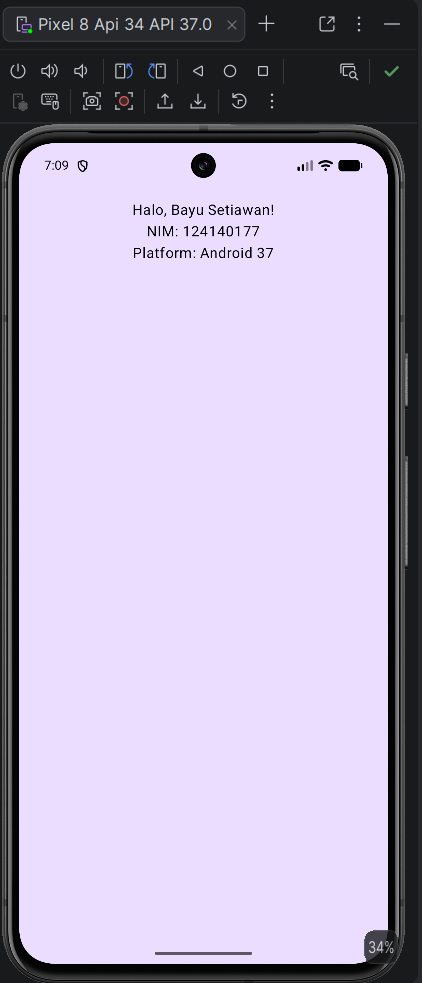

# Praktikum 1 — My First KMP App

## Identitas

**Nama:** Bayu Setiawan  
**NIM:** 124140177  
**Mata Kuliah:** Pengembangan Aplikasi Mobile  
**Praktikum:** Minggu 1

## Deskripsi

Project pertama menggunakan **Kotlin Multiplatform (KMP)** dan **Compose Multiplatform**.
Aplikasi sederhana yang menampilkan informasi identitas mahasiswa beserta platform yang digunakan.

## Hasil

Aplikasi menampilkan:

- Halo, Bayu Setiawan!
- NIM: 124140177
- Platform: Android 37

## Teknologi

- Kotlin Multiplatform (KMP)
- Compose Multiplatform
- Material 3
- Gradle (Kotlin DSL)

## Struktur Project

```
Praktikum1/
├── androidApp/          → Aplikasi Android (MainActivity.kt)
├── iosApp/              → Aplikasi iOS
├── shared/
│   └── src/
│       ├── commonMain/  → Kode bersama (App.kt, Greeting.kt, Platform.kt)
│       ├── androidMain/ → Platform spesifik Android
│       └── iosMain/     → Platform spesifik iOS
├── build.gradle.kts
└── settings.gradle.kts
```

## Cara Menjalankan

1. Buka folder `Praktikum1` menggunakan **Android Studio**
2. Pastikan emulator Android sudah tersedia
3. Pilih perangkat Android (misalnya **Pixel 8 API 34**)
4. Jalankan aplikasi menggunakan tombol **Run ▶**

## Screenshot


