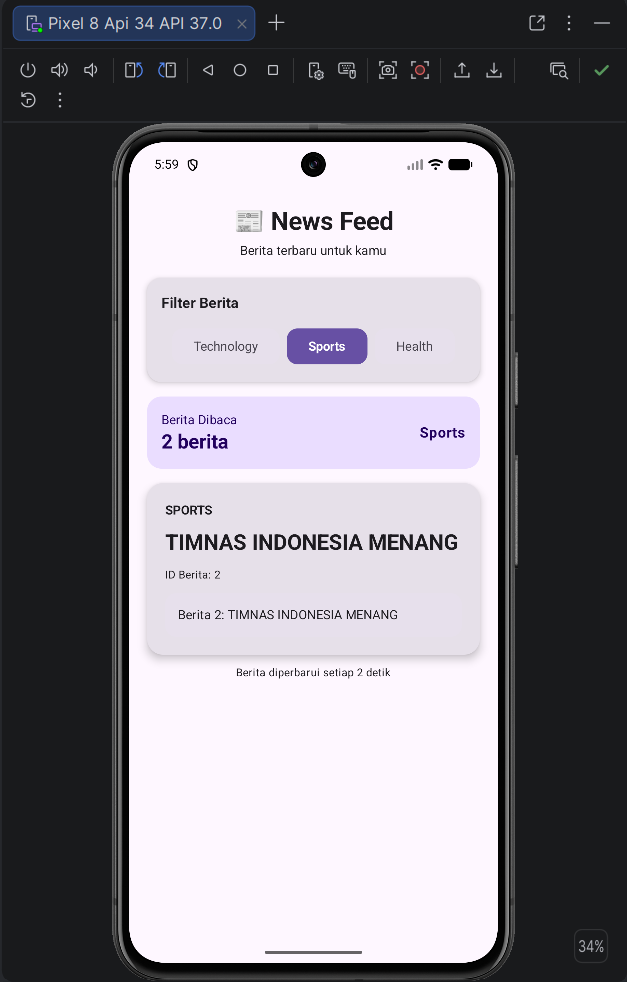

# Praktikum 2 — News Feed Simulator

## Identitas

**Nama:** Bayu Setiawan  
**NIM:** 124140177  
**Mata Kuliah:** Pengembangan Aplikasi Mobile  
**Praktikum:** Minggu 2

## Deskripsi

Aplikasi **News Feed Simulator** yang mensimulasikan penerimaan berita secara berkala.
Menerapkan konsep **Kotlin Coroutines** dan **Flow** untuk pemrograman asinkronus.

Aplikasi menampilkan berita berdasarkan beberapa kategori dan memungkinkan pengguna
memilih kategori berita yang ingin ditampilkan.

Kategori yang tersedia:

- Technology
- Sports
- Health

## Fitur

Aplikasi menerapkan beberapa konsep Kotlin Coroutines dan Flow, yaitu:

| Konsep | Penjelasan |
|--------|------------|
| **Flow** | Menghasilkan berita baru setiap 2 detik |
| **Filter** | Memfilter berita berdasarkan kategori |
| **Map** | Transformasi judul berita menjadi huruf kapital |
| **onEach** | Menjalankan aksi saat data berita diterima |
| **Collect** | Menerima dan memproses data dari Flow |
| **StateFlow** | Menyimpan jumlah berita yang telah dibaca |
| **Async/Await** | Mengambil detail berita secara asynchronous |

## Teknologi

- Kotlin
- Kotlin Multiplatform
- Compose Multiplatform
- Kotlin Coroutines
- Flow & StateFlow
- Material 3
- Android Studio

## Struktur Project

```
Praktikum2/
├── androidApp/          → Aplikasi Android (MainActivity.kt)
├── iosApp/              → Aplikasi iOS
├── shared/
│   └── src/
│       └── commonMain/
│           └── kotlin/.../
│               ├── App.kt          → Entry point & UI News Feed
│               ├── NewsFeed.kt     → Data class News, newsFlow(), NewsManager
│               ├── Greeting.kt
│               ├── GreetingUtil.kt
│               └── Platform.kt
├── build.gradle.kts
└── settings.gradle.kts
```

## File Utama

| File | Fungsi |
|------|--------|
| `App.kt` | Entry point aplikasi, berisi `NewsFeedApp()` dan UI utama |
| `NewsFeed.kt` | Data class `News`, `newsFlow()`, `NewsManager`, `fetchNewsDetail()` |

## Cara Menjalankan

1. Buka folder `Praktikum2` menggunakan **Android Studio**
2. Pastikan emulator Android sudah tersedia
3. Pilih perangkat Android (misalnya **Pixel 8 API 34**)
4. Jalankan aplikasi menggunakan tombol **Run ▶**

## Pengujian

- Menjalankan aplikasi pada emulator Android
- Menampilkan berita secara berkala
- Memilih kategori **Technology**, **Sports**, dan **Health**
- Menampilkan jumlah berita yang telah dibaca
- Mengambil detail berita menggunakan proses asynchronous

## Screenshot


