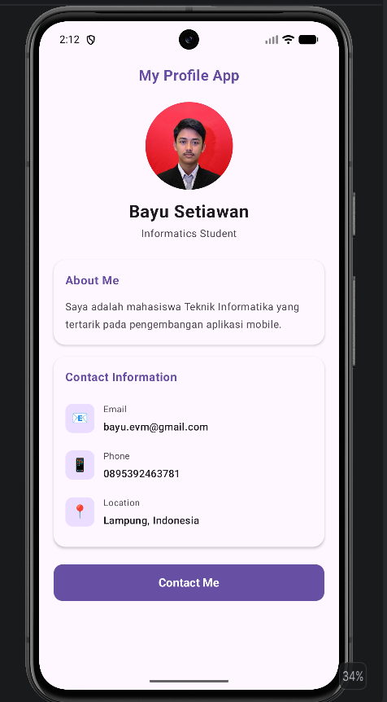

# Praktikum 3 — My Profile App

## Identitas

**Nama:** Bayu Setiawan  
**NIM:** 124140177  
**Mata Kuliah:** Pengembangan Aplikasi Mobile  
**Praktikum:** Minggu 3

## Deskripsi

Aplikasi **My Profile App** yang menampilkan informasi profil pengguna menggunakan
**Compose Multiplatform** dan **Material 3**.

Mengimplementasikan **reusable composable** untuk komponen UI yang modular dan dapat digunakan kembali.

## Fitur

- 📸 **Profile Photo** — Foto profil berbentuk circular
- 👤 **Profile Header** — Nama dan status pengguna
- 📝 **About Me** — Deskripsi singkat tentang pengguna
- 📧 **Contact Information** — Email, Phone, Location
- 🔘 **Contact Me Button** — Tombol kontak

## Reusable Composable

| Composable | Fungsi |
|------------|--------|
| `ProfileHeader()` | Header profil dengan foto circular, nama, dan status |
| `InfoItem()` | Baris informasi kontak dengan icon emoji dan teks |
| `ProfileCard()` | Card reusable untuk menampilkan section (About Me, Contact) |

## Teknologi

- Kotlin
- Compose Multiplatform
- Material 3
- Compose Resources (untuk gambar profil)
- Android Studio

## Struktur Project

```
Praktikum3/
├── androidApp/          → Aplikasi Android (MainActivity.kt)
├── iosApp/              → Aplikasi iOS
├── shared/
│   └── src/
│       └── commonMain/
│           ├── composeResources/
│           │   └── drawable/
│           │       └── profile_photo.jpg
│           └── kotlin/.../
│               ├── App.kt          → Entry point, memanggil ProfileApp()
│               ├── ProfileApp.kt   → UI profil & 3 reusable composable
│               ├── Greeting.kt
│               ├── GreetingUtil.kt
│               └── Platform.kt
├── build.gradle.kts
└── settings.gradle.kts
```

## File Utama

| File | Fungsi |
|------|--------|
| `App.kt` | Entry point aplikasi, memanggil `ProfileApp()` |
| `ProfileApp.kt` | Seluruh UI profil dan 3 reusable composable |

## Cara Menjalankan

1. Buka folder `Praktikum3` menggunakan **Android Studio**
2. Pastikan emulator Android sudah tersedia
3. Pilih perangkat Android (misalnya **Pixel 8 API 34**)
4. Jalankan aplikasi menggunakan tombol **Run ▶**

## Screenshot


